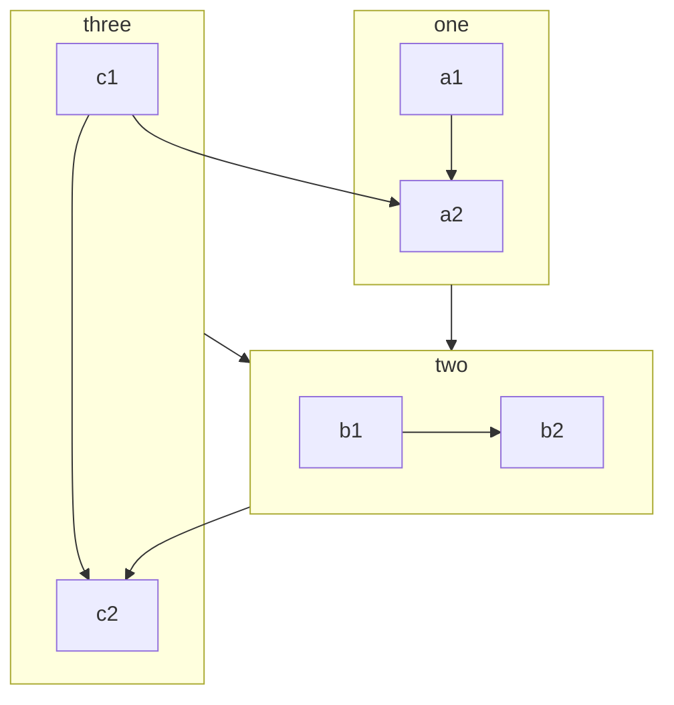

> **English** | [中文](markdown.zh.md)

VuePress generates pages mainly from Markdown files. So you can use it to easily create a documentation or blog site.

You should create and write Markdown files, so that VuePress can convert them into different pages according to the file structure.

<!-- more -->

## Markdown intro

If you are a beginner and cannot write Markdown yet, please read [Markdown intro](https://vuepress-theme-hope.github.io/v2/zh/cookbook/markdown/) and [Markdown demo](https://vuepress-theme-hope.github.io/v2/zh/cookbook/markdown/demo.html) first.

## Markdown config

VuePress introduces configuration for each Markdown page through the Frontmatter.

::: info

Frontmatter is a very important concept in VuePress. If you are not familiar with it, you need to read the [Frontmatter intro](https://vuepress-theme-hope.github.io/v2/zh/cookbook/vuepress/page.html#front-matter).

:::

## Markdown extensions

VuePress uses [markdown-it](https://github.com/markdown-it/markdown-it) to parse the Markdown content, so you can implement [syntax extensions](https://github.com/markdown-it/markdown-it#syntax-extensions) with markdown-it plugins.

### VuePress extensions

To enrich documentation writing, VuePress has extended the Markdown syntax.

For these extensions, please read [Markdown extensions in VuePress](https://vuepress-theme-hope.github.io/v2/zh/cookbook/vuepress/markdown.html).

### Theme extensions

Through [`vuepress-plugin-md-enhance`][md-enhance], the theme extends more Markdown syntax, providing richer writing features.

#### Custom containers

::: v-pre

Use {{ variable }} safely in Markdown.

:::

::: info Custom title

Info container, with `code` and a [link](#custom-containers).

```js
const a = 1;
```

:::

::: tip Custom title

Tip container

:::

::: warning Custom title

Warning container

:::

::: danger Custom title

Danger container

:::

::: details Custom title

Details container

:::

:::: details Code

```md
::: v-pre

安全的在 Markdown 中使用 {{ variable }}。

:::

::: info 自定义标题

信息容器

:::

::: tip 自定义标题

提示容器

:::

::: warning 自定义标题

警告容器

:::

::: danger 自定义标题

危险容器

:::

::: details 自定义标题

详情容器

:::
```

::::

- [See details](https://vuepress-theme-hope.github.io/v2/zh/guide/markdown/container.html)

#### Code blocks

::: code-tabs

@tab pnpm

```bash
pnpm add -D vuepress-theme-hope
```

@tab yarn

```bash
yarn add -D vuepress-theme-hope
```

@tab:active npm

```bash
npm i -D vuepress-theme-hope
```

:::

- [See details](https://vuepress-theme-hope.github.io/v2/zh/guide/markdown/code-tabs.html)

#### Superscript and subscript

19^th^ H~2~O

- [See details](https://vuepress-theme-hope.github.io/v2/zh/guide/markdown/sup-sub.html)

#### Custom alignment

::: center

I am centered

:::

::: right

I am right-aligned

:::

- [See details](https://vuepress-theme-hope.github.io/v2/zh/guide/markdown/align.html)

#### Attrs

A **word**{#word} with an ID.

- [See details](https://vuepress-theme-hope.github.io/v2/zh/guide/markdown/attrs.html)

#### Footnotes

This text has a footnote[^first].

[^first]: This is the footnote content

- [See details](https://vuepress-theme-hope.github.io/v2/zh/guide/markdown/footnote.html)

#### Mark

You can mark ==important content==.

- [See details](https://vuepress-theme-hope.github.io/v2/zh/guide/markdown/mark.html)

#### Task lists

- [x] Plan 1
- [ ] Plan 2

- [See details](https://vuepress-theme-hope.github.io/v2/zh/guide/markdown/tasklist.html)

### Image enhancement

Supports setting color mode and size for images

- [See details](https://vuepress-theme-hope.github.io/v2/zh/guide/markdown/image.html)

#### Chart

::: chart An example of a scatter chart

```json
{
  "type": "scatter",
  "data": {
    "datasets": [
      {
        "label": "散点数据集",
        "data": [
          { "x": -10, "y": 0 },
          { "x": 0, "y": 10 },
          { "x": 10, "y": 5 },
          { "x": 0.5, "y": 5.5 }
        ],
        "backgroundColor": "rgb(255, 99, 132)"
      }
    ]
  },
  "options": {
    "scales": {
      "x": {
        "type": "linear",
        "position": "bottom"
      }
    }
  }
}
```

:::

- [See details](https://vuepress-theme-hope.github.io/v2/zh/guide/markdown/chart.html)

#### Echarts

::: echarts An example of a line chart

```json
{
  "xAxis": {
    "type": "category",
    "data": ["Mon", "Tue", "Wed", "Thu", "Fri", "Sat", "Sun"]
  },
  "yAxis": {
    "type": "value"
  },
  "series": [
    {
      "data": [150, 230, 224, 218, 135, 147, 260],
      "type": "line"
    }
  ]
}
```

:::

- [See details](https://vuepress-theme-hope.github.io/v2/zh/guide/markdown/echarts.html)

#### Flowchart

```flow
cond=>condition: 是否执行操作?
process=>operation: 操作
e=>end: 结束

cond(yes)->process->e
cond(no)->e
```

- [See details](https://vuepress-theme-hope.github.io/v2/zh/guide/markdown/flowchart.html)

#### Mermaid



- [See details](https://vuepress-theme-hope.github.io/v2/zh/guide/markdown/mermaid.html)

#### Tex syntax

$$
\frac {\partial^r} {\partial \omega^r} \left(\frac {y^{\omega}} {\omega}\right)
= \left(\frac {y^{\omega}} {\omega}\right) \left\{(\log y)^r + \sum_{i=1}^r \frac {(-1)^i r \cdots (r-i+1) (\log y)^{r-i}} {\omega^i} \right\}
$$

- [See details](https://vuepress-theme-hope.github.io/v2/zh/guide/markdown/tex.html)

#### Include file

@include(./README.md{13-19})

- [See details](https://vuepress-theme-hope.github.io/v2/zh/guide/markdown/include.html)

#### Code demo

::: normal-demo A normal demo

```html
<h1>VuePress Theme Hope</h1>
<p><span id="very">非常</span>强大!</p>
```

```js
document.querySelector("#very").addEventListener("click", () => {
  alert("非常强大");
});
```

```css
span {
  color: red;
}
```

:::

- [See details](https://vuepress-theme-hope.github.io/v2/zh/guide/markdown/demo.html)

#### Stylize

Donated Mr.Hope a cup of coffee. _Recommended_

- [See details](https://vuepress-theme-hope.github.io/v2/zh/guide/markdown/stylize.html)

#### Interactive demo

::: playground#ts TS example

@file index.ts

```ts
const msg = "hello world";

const speak = (msg: string) => console.log(msg);

speak(msg);
```

:::

- [See details](https://vuepress-theme-hope.github.io/v2/zh/guide/markdown/playground.html)

#### Vue interactive demo

::: vue-playground Vue interactive demo

@file App.vue

```vue
<script setup>
import { ref } from "vue";

const msg = ref("Hello World!");
</script>

<template>
  <h1>{{ msg }}</h1>
  <input v-model="msg" />
</template>
```

:::

- [See details](https://vuepress-theme-hope.github.io/v2/zh/guide/markdown/vue-playground.html)

#### Slides

@slidestart

## Slide 1

A paragraph with text and a [link](https://mrhope.site)

---

## Slide 2

- Item 1
- Item 2

---

## Slide 3.1

```js
const a = 1;
```

--

## Slide 3.2

$$
J(\theta_0,\theta_1) = \sum_{i=0}
$$

@slideend

- [See details](https://vuepress-theme-hope.github.io/v2/zh/guide/markdown/presentation.html)

[md-enhance]: https://vuepress-theme-hope.github.io/v2/md-enhance/zh/
